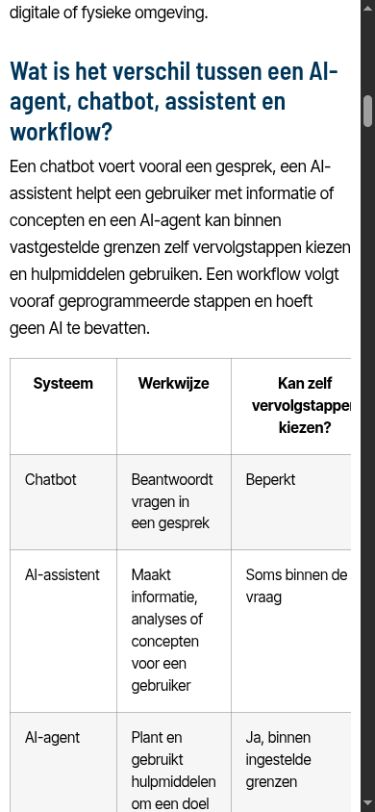
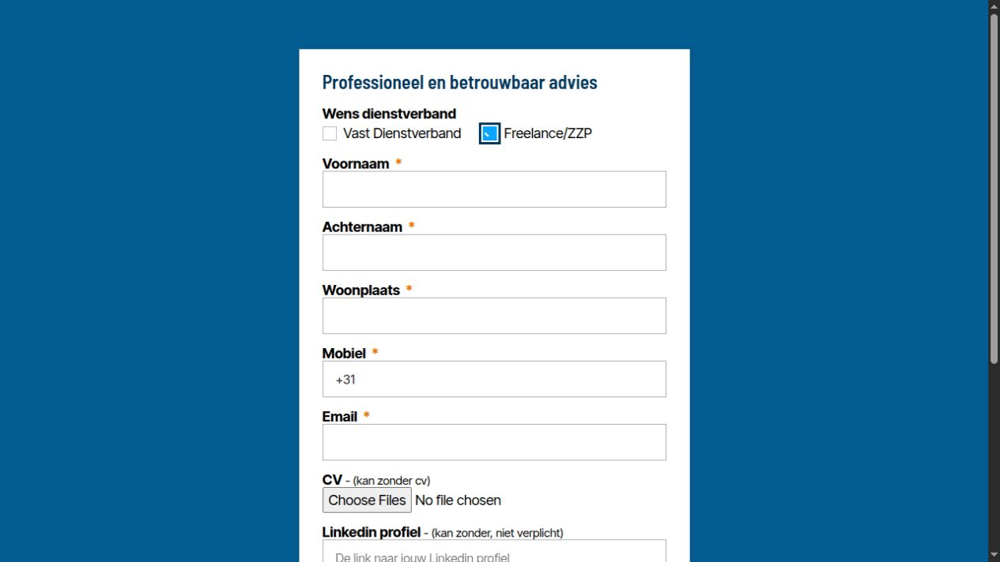

# Audit TFSC Custom Functions — 1 november 2026

## Uitkomst

De plugin is nog nodig voor de globale websiteopmaak en enkele instellingen. De CSS bevat geen fatale structuur- of declaratiesyntaxisfouten in de uitgevoerde parsercontrole. Er zijn wel functionele fouten, overbodige regels en onderhoudsproblemen gevonden. Het onderzoek is geen bewijs dat iedere niet aangetroffen selector overal en altijd ongebruikt is.

De oorspronkelijke live plugin is volledig en ongewijzigd geëxporteerd: `tfsc-custom-functions.php` (3.854 bytes), `tfsc-custom-stylesheet.css` (18.544 bytes) en `custom-stylesheet-wp-admin.css` (626 bytes). De originele kopie en manifest staan onder `wordpress/exports/plugins/2026-11-01-before-custom-functions-cleanup/`. De tijdelijke exportfunctie is verwijderd; de exportroute gaf daarna HTTP 404.

## Omvang en methode

- 171 openbare HTML-pagina's met HTTP 200, gespreid over homepage, reguliere pagina's, formulieren, artikelen, vacatures, ingevulde vacatures, taxonomieën en vacaturecombinaties.
- Alle 28 gepubliceerde reguliere pagina's via REST. Sitemap- en REST-tellingen verschillen, onder andere door niet-geïndexeerde formulieren en archief-URL's in sitemaps.
- 96 Elementor-bibliotheekitems met status gepubliceerd of concept.
- Gepubliceerde inhoud: 58 Beroepengids-artikelen, 4 blogs, 76 Kennisbankartikelen, 63 vacatures en 68 ingevulde vacatures.
- Actieve Code Snippets op verwijzingen onderzocht. Broncode en eventuele geheimen uit deze snippets zijn niet in GitHub opgeslagen.
- De 141 CSS-regelblokken bevatten samen 218 afzonderlijke selectors. 125 selectors matchen de opgehaalde HTML. Voor 43 andere selectors zijn potentiële bronverwijzingen gevonden; dit bewijst geen daadwerkelijk gebruik. 50 selectors zijn niet aangetroffen in HTML of de onderzochte inhouds-/templatebronnen. Daar zitten ook generieke koppen en dynamische Elementor-staten tussen die bewust behouden zijn.

Bij het zoeken naar potentieel gebruik zijn onder andere hover-, focus- en checked-staten genegeerd. Een match betekent dus dat de doelstructuur voorkomt, niet dat de stijl zichtbaar is of andere CSS overschrijft. Bronverwijzingen kunnen ook CSS-tekst zijn in plaats van echte klasseattributen. De inventaris is een hulpmiddel voor beoordeling, geen automatisch verwijderadvies.

De gecombineerde vacature-sitemaps bevatten ruim duizend URL's. Die zijn bemonsterd; niet iedere combinatiepagina of iedere artikelpagina is in een browser geopend. Het is geen volledige websitecrawl of meting van CSS-dekking tijdens alle interacties.

## Gevonden fouten en verbeteringen

| Bevinding | Bewijs | Aanpassing in 0.3.0 |
| --- | --- | --- |
| Vast CSS-versienummer | De live pagina verwijst naar `tfsc-custom-stylesheet.css?ver=0.1.0`; hetzelfde staat in de geëxporteerde PHP-code. | `filemtime()` bepaalt de versie. Getest met twee verschillende wijzigingsdatums. |
| Dubbele slash in CSS-pad | De live ongeoptimaliseerde URL bevat `tfsc-custom-functions//tfsc-custom-stylesheet.css`. | Padconstructie gecorrigeerd. |
| Focus van links verborgen | `a:focus,.submit:focus { outline: 0 !important }`. Op het adviesformulier kreeg de privacy-link toetsenbordfocus maar bleef de gemeten outline `none 0px`. | Globale onderdrukking vervangen door `:focus-visible`. |
| Focus van checkboxen niet zichtbaar op het vakje | De echte checkbox is tot 1 px verkleind en geclipt. Het zichtbare labelvakje heeft geen focusring. | Focusring op `label::before`. |
| Brede tabellen rekken mobiele artikelen uit | Op een scherm van 390 px wordt de Kennisbankkopie 549 px breed. Het tabelkader heeft `overflow:visible`. | Het kader krijgt `overflow-x:auto`; beide geteste artikelen blijven nu binnen het scherm. |
| Link en zinsrest vormen losse kolommen in opsomming | Op de vacature Service Monteur Rotating Equipment Internationaal heeft het item met de link Basissalaris `display:flex` en `gap:14px`; de browsertekst toont een scheiding tussen de link en de rest. | Normale blokopmaak met een absoluut gepositioneerd vierkant opsommingsteken. |
| Eén identiek stijlblok dubbel | `.elementor-form .elementor-field-type-hidden` op originele regels 688 en 717. | De laatste regel behouden. |
| Eén leeg stijlblok | `.tfsc-query-show-more__label` op originele regel 459. | Verwijderd, zonder de gegenereerde labelklasse zelf weg te halen. |
| Verouderde fontpreloads | PHP laadt Inter v12 vooraf. De actieve eigen CSS en Elementor-kit gebruiken Inter Tight en Barlow Semi Condensed. | Preloads naar Inter Tight 400 en Barlow 600. Alle gecontroleerde bestaande fontbestanden geven HTTP 200. |
| Blokstijlen globaal uitgezet | PHP dequeuet `wp-block-library` en `wp-block-library-theme`. De onderzochte HTML bevat onder meer 40 tabelblokken en 13 afbeeldingsblokken. | Globale uitschakeling verwijderd. Dit is een bewuste mogelijke visuele verandering en vereist een volledige WordPress-test. |
| Leesduur niet robuust | Oudere callback veronderstelt een geldige globale post, gebruikt `str_word_count` en geeft bijvoorbeeld `1 minuten`. | Ontbrekende post afgevangen, Unicode-woordtelling en enkelvoud toegevoegd. |

## Beoordeling van de PHP-functies

De [verdiepende controle](php-verdieping.md) beoordeelt ook de oude callbacknamen, indirecte shortcodeverwijzingen en het werkelijke WordPress-gedrag. Er zijn 13 aanvullende controles met WordPress-hulpfuncties geslaagd; een volledige Elementor-runtimecontrole blijft afzonderlijk nodig.

| Onderdeel in oude plugin | Nodig / besluit | Onderbouwing |
| --- | --- | --- |
| Recente-reacties-widgetstijl uitschakelen | Verwijderd uit kandidaat | Geen recent-comments-widget in onderzochte output aangetroffen; legacy-optimalisatie. WordPress kan een eventuele toekomstige widget weer normaal stylen. |
| Google Fonts van Elementor uitschakelen | Behouden | De site gebruikt lokaal gehoste fonts. Dit voorkomt ongewenste externe fontverzoeken. |
| Font Awesome-stijlen deregistreren | Behouden | Geen fontgebaseerde `i`/`span`-iconen in onderzochte HTML aangetroffen; bestaande widgets gebruiken SVG. Dit is geen garantie voor alle toekomstige widgets. |
| Uitgecommentarieerde Eicons-code | Verwijderd als dode code | Was al niet actief. Eicons zijn niet alsnog uitgeschakeld. |
| Gutenberg-stijlen globaal uitschakelen | Verwijderd | Blokken worden daadwerkelijk gebruikt; de blokkade kan noodzakelijke standaardopmaak weghalen. |
| Elementor-zoekresultatentitel | Behouden | Functionele aanpassing voor zoekpagina's. Doorvoer en HTML-escaping getest. |
| Eigen CSS laden | Behouden en hersteld | Nodig voor de huisstijl; bestaand stylesheet-handle en laadvolgorde behouden. |
| Twee oude Inter-preloads | Vervangen | Bestanden bestaan nog, maar komen niet overeen met de huidige fontfamilies. |
| `rm_get_estimated_time_to_read` | Behouden en verbeterd | Aangetroffen in opgeslagen gepubliceerde Elementor-template 18786. Of die template nu op een publieke pagina wordt ingezet is niet aangetoond. |
| `current_page_url` | Voorlopig behouden | Geen verwijzing in de onderzochte bronnen gevonden. Kan nog buiten deze bronnen worden gebruikt; bewaren kost weinig en voorkomt een onnodige breuk. |
| `custom-stylesheet-wp-admin.css` | Alleen in back-up | De plugin laadt het bestand niet en er is geen verwijzing in de onderzochte actieve snippets/inleidende adminweergave gevonden. Het bevat slechts één oude locatie-taxonomieregel. Geen reden om dit bestand opnieuw te activeren. |

## Gearchiveerde CSS

19 regelblokken voor 13 privéklassen/ID's zijn uit het actieve CSS-bestand gehaald. Hun markers zijn niet gevonden in de onderzochte HTML, gepubliceerde inhoud, gepubliceerde/concept-templates of actieve snippets:

`bkgr-white`, `bkgr-black`, `link-underline`, `button-trans-black`, `button-black-trans`, `button-white-blue`, `button-green-white-3d`, `button-trans-orange`, `testimonial-home`, `blog-subnav`, `elementor-element-52ef2827`, `elementor-element-70547f4f`, `align-icon-list`.

De originele regels staan in `wordpress/exports/plugins/2026-11-01-before-custom-functions-cleanup/unused-selectors.css`. De volledige originele stylesheet blijft daarnaast byte-identiek in de back-up aanwezig. De 118 niet-bedoeld-gewijzigde regelvoorkomens behouden dezelfde declaraties en volgorde; twee bestaande regels zijn doelbewust aangepast voor opsommingen.

Niet verwijderd: generieke H1–H6-regels, popupstijlen, checkboxstaten, de dynamische Meer-knop, de reCAPTCHA-badge-regel, scrollankers en tijdelijk niet aangetroffen maar herbruikbare Elementor-selectors. Het ontbreken van een match in een HTML-steekproef is daarvoor onvoldoende.

## Uitgevoerde validatie

- SHA-256 van alle drie de live back-upbestanden gecontroleerd.
- Alle acht gecontroleerde font-/icoonassets bestaan en geven HTTP 200.
- 18 functionele controles op PHP 8.3.33 met WordPress-stubs: versie na opslaan, ontbrekende CSS, naam/volgorde stylesheet, zoektekst-escaping, geen post, woorden met accenten, leestijd, oude shortcode-namen en fontinstellingen.
- 41 CSS-/bronnencontroles: structuur/declaraties, geen aangetroffen bronverwijzingen voor gearchiveerde selectors, exact 19 gearchiveerde regels, behoud van andere declaraties, correcte focusregels, minder-beweginginstelling, dynamische Elementor-stijlen behouden.
- Live browser: homepage, adviesformulier, toetsenbordfocus, vacature met inline link en een via JavaScript ingevoegde Meer-knop gecontroleerd.

### Visuele vervolgcontrole na aangepaste browsertoestemming

De lokale browsertoegang en mobiele scherminstelling werken nu. Zes paginatypen zijn met oude en nieuwe CSS vergeleken op desktop (1280 × 720) en mobiel (390 × 844): homepage, adviesformulier, vacature, blogartikel, vacaturearchief en Kennisbankartikel. Dit zijn 12 voor/na-paren en 24 paginaladingen. De inhoud en aantallen gemeten elementen blijven gelijk. De gemeten stijlen verschillen uitsluitend bij de bedoelde lijstaanpassingen.

Geen nieuwe kopie heeft horizontale pagina-overloop. De blog- en Kennisbankkopieën hadden die op mobiel wel met de oude CSS. Brede tabellen schuiven nu binnen hun eigen kader. De browser bevestigt ook dat de tekst 'Basissalaris afhankelijk van jouw kennis en werkervaring' één doorlopende zin is geworden. De formuliercheckbox heeft een zichtbare focusrand en is met de spatiebalk aangevinkt; het zichtbare vinkje verscheen. Geen formulier is verstuurd.

Dit zijn statische HTML-kopieën met scripts en iframes verwijderd en formulierverzending uitgeschakeld. Afbeeldingen die via lazy loading verschijnen zijn placeholders. Dynamische filters, menu's en popups zijn hiermee niet volledig getest. De nieuwe PHP-plugin is nog niet binnen een volledige WordPress-/Elementoromgeving geladen. Vooral het hervatten van native WordPress-blokstijlen vereist nog die controle. De meetresultaten staan in `browser-validation.json`.

## Nog beoordelen vóór live plaatsing

1. Native blokstijlen: tabellen, afbeeldingen, groepen en afscheidingslijnen kunnen er anders uitzien nadat de globale blokkade verdwijnt.
2. De statisch gecontroleerde lijsten en tabellen ook in de werkende WordPress-/Elementoromgeving bekijken, inclusief geneste lijsten.
3. Focusringen op lichte en donkere achtergronden en dynamische menu’s in de volledige omgeving controleren. De statische checkboxbediening is geslaagd.
4. Mobiele header, archieffilters, popups/offcanvas, Meer-knoppen en formulieren.
5. Cache vernieuwen bij plaatsing: CSS-versienummer alleen kan eerder opgeslagen HTML in LiteSpeed/CDN niet herschrijven.

Er is geen noodzaak aangetoond om alle CSS naar Elementor te verplaatsen. De huidige plugin blijft geschikt als centrale plek voor globale aanvullingen, mits de broncode en caches goed worden beheerd.

## Documentatie

- [WordPress: stylesheet-versie en cache busting](https://developer.wordpress.org/reference/functions/wp_enqueue_style/).
- [WordPress: blokstijlen](https://developer.wordpress.org/reference/functions/wp_enqueue_block_style/).
